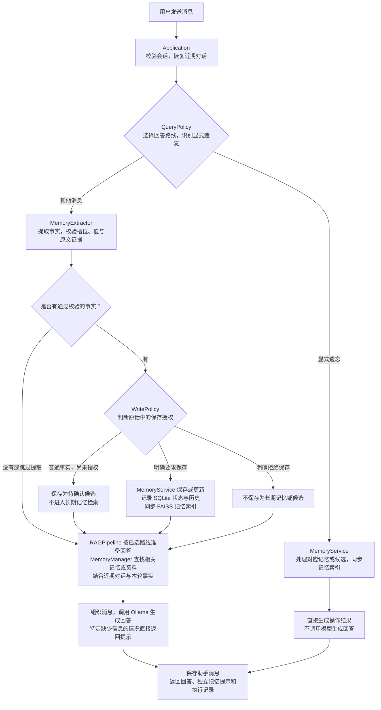
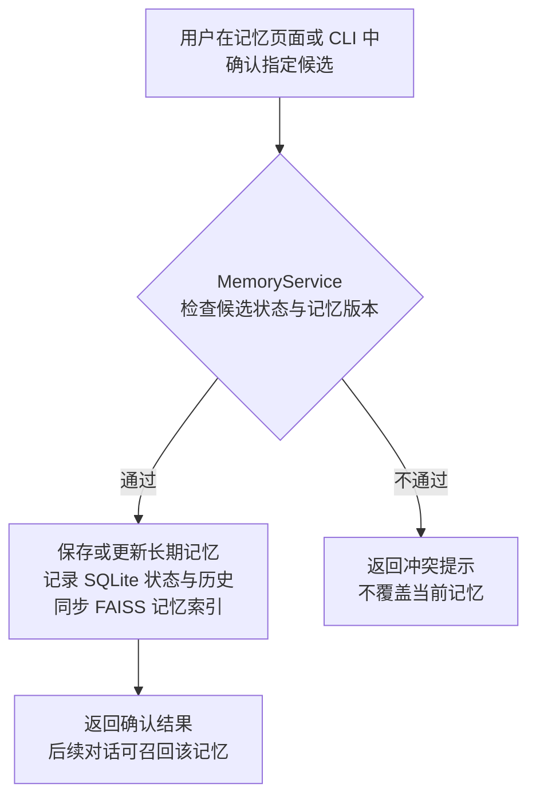

# DiscreteMemory：支持长期记忆的对话系统

DiscreteMemory 是一个支持长期记忆的对话系统：通过用户授权保存、更新和遗忘个人信息，并在后续对话中召回使用；同时支持导入资料进行问答。

项目基于前期 Memory-RAG-System 迭代，面向跨会话信息丢失、个人事实更新和旧记忆误用问题。

系统将**事实提取、保存授权和聊天回答分开处理**：模型负责理解原话并提出候选，程序负责校验与状态变更，回答阶段结合近期对话、有效长期记忆和文档资料。日常事实不会因被模型识别就自动进入长期记忆。

技术栈：**Python · Ollama · BGE · FAISS · SQLite · FastAPI**。

## 1. 核心能力与项目演进

| 能力 | 当前实现 |
| --- | --- |
| 记忆提取与授权 | LLM 输出带原文证据的结构化候选；普通事实待确认，明确要求保存时写入；拒绝保存优先 |
| 跨会话召回 | 根据问题选择槽位读取、有效记忆列表或 BGE + FAISS 语义检索 |
| 更新与版本管理 | 单值事实更新同一记录并保留历史；候选确认时检查版本，避免旧候选覆盖新值 |
| 多值偏好与删除 | 不同偏好可并存，相同值去重；支持按条删除和清理已删除记录 |
| 上下文管理 | 当前/近期的本人陈述优先于冲突的长期值；只改变本轮回答背景，不隐式修改长期记忆 |
| 会话与可追踪结果 | Web/CLI 对话、会话删除、独立记忆回执及执行 trace；删除会话不删除已保存长期记忆 |
| 资料问答 | UTF-8 TXT/Markdown 资料导入、分块、更新、删除和检索增强问答 |

开发者使用固定多轮 Demo、记忆有无对照和组件诊断验证系统；评测脚本独立运行，保留失败记录。

### 开发时间与版本演进

项目分两个阶段开发，当前长期记忆系统的主要迭代时间为 **2026.09–2026.10**。

| 开发时间 | 阶段与版本 | 主要工作 |
| --- | --- | --- |
| 2026.03–2026.05 | Memory-RAG 原型 · [memory-rag-v1](https://github.com/LiuSunshine1223/Agent-Memory/tree/memory-rag-v1) | 构建本地知识问答、知识/用户记忆双库检索、多轮上下文和早期记忆写入流程 |
| 2026.09–2026.10 | 长期记忆系统迭代 · [main](https://github.com/LiuSunshine1223/Agent-Memory/tree/main) | 完善模型候选提取、保存授权、SQLite 状态与版本、索引恢复、Web 交互及读取侧对照评测 |

旧原型通过 `memory-rag-v1` 标签保留；当前版本在 `main` 分支维护，具体改动可查阅[提交历史](https://github.com/LiuSunshine1223/Agent-Memory/commits/main/)。

当前版本继承原项目的模型接入、检索与对话基础，重点扩展记忆的生命周期管理。原型中的 Cross-Encoder 重排和显存监控未保留在当前主流程。

## 2. 快速运行

### 环境

- Python 3.9 或以上；已有验证环境为 Ubuntu/WSL、Python 3.9.25。
- [Ollama](https://docs.ollama.com/quickstart) 用于本地生成，默认模型为 `llama3:8b`。
- [BGE-small-zh-v1.5](https://huggingface.co/BAAI/bge-small-zh-v1.5) 用于文本向量化，输出维度为 512。
- BGE 可使用 CPU 或 PyTorch 可用的 CUDA；当前 FAISS `IndexFlatL2` 索引在 CPU 上运行。CPU 可以运行，但生成耗时取决于硬件与模型。

以下命令均在项目根目录、已激活的 Python 环境中执行。

### 安装依赖

```bash
python -m pip install -r requirements.txt
```

`requirements.txt` 默认安装 `faiss-cpu`。已有环境如果使用 `faiss-gpu`，不要叠装两种发行包；已验证的旧环境使用 `faiss-gpu 1.7.2`，与默认依赖声明不同。依赖采用版本范围，新建环境应重新验证，不保证与历史评测环境完全一致。

### 配置模型与服务

首次运行时，把 `.env.example` 复制为 `.env`。已有 `.env` 时编辑现有文件即可。模板仅列常用模型与存储配置；服务端口、分块和检索参数等省略时使用 `config.py` 的默认值，需要调整时再加入 `.env`。

```bash
# Linux / WSL
cp .env.example .env
```

```powershell
# Windows PowerShell
Copy-Item .env.example .env
```

将 BGE 模型完整下载到 `models/bge-small-zh-v1.5/`；也可以在 `.env` 中把 `EMBED_MODEL_PATH` 改为 `BAAI/bge-small-zh-v1.5`，由 SentenceTransformer 在首次加载时下载。离线运行应准备完整本地模型目录。

关键配置示例：

```dotenv
OLLAMA_URL=http://localhost:11434/api/generate
LLM_MODEL=llama3:8b
LLM_TIMEOUT_SECONDS=120
EMBED_MODEL_PATH=./models/bge-small-zh-v1.5
VECTOR_DIM=512
API_HOST=127.0.0.1
API_PORT=8000
```

启动 Ollama 服务并准备生成模型：

```bash
# 如果桌面程序已启动服务，无需重复执行 serve
ollama serve
```

在另一个终端执行：

```bash
ollama pull llama3:8b
ollama list
```

若 Python 在 WSL、Ollama 在 Windows，`OLLAMA_URL` 的主机地址应设置为 WSL 实际可访问的地址。适配器会根据配置转换到 `/api/chat`，以 system/user/assistant 消息调用模型。

### 启动网页

```bash
python main.py --serve
```

浏览器打开 `http://127.0.0.1:8000/`，接口文档位于 `http://127.0.0.1:8000/docs`。新建会话后即可聊天；知识问答需要先在资料页面导入 TXT/Markdown 文件。

项目统一从 `main.py` 启动，不同参数选择运行方式：

| 命令 | 作用 |
| --- | --- |
| `python main.py --serve` | 启动网页与 FastAPI 服务 |
| `python main.py` | 控制台交互 |
| `python main.py --demo` | 执行固定的真实模型多轮场景，保存检查报告 |
| `python main.py --list-memories` | 读取 SQLite 中的有效记忆，不加载模型 |
| `python main.py --import-legacy-memories` | 显式迁移旧向量记忆；仅适用于符合条件的全新 SQLite workspace |

这些运行选项互斥。迁移前保留旧索引备份；日常启动不自动导入旧记忆。若存在旧知识索引但没有文档 catalog，应保留旧文件、改用空的 `BASE_DB_PATH`，再通过资料页面重新导入来源文档。

### PyCharm 配置

| 配置项 | 填写内容 |
| --- | --- |
| Script path | 项目根目录的 `main.py` |
| Working directory | 项目根目录 |
| Python interpreter | 已安装依赖的 Python 环境；已有 WSL `memory_rag` 环境可继续使用 |
| Parameters | 网页填 `--serve`；控制台留空；固定演示填 `--demo` |

运行配置名称仅用于区分，实际行为由脚本参数决定。项目文件夹名称不影响启动，运行数据相对路径以 `config.py` 所在的项目根目录为基准。

## 3. 使用示例

下面展示的是预期状态变化，具体回答由模型生成。

| 操作 | 预期行为 |
| --- | --- |
| 在会话 A 输入“我准备找 NLP 方向的实习，你能给些建议吗？” | 正常回答问题，同时提出待确认候选 |
| 在记忆页面确认该候选 | 写入有效长期记忆 |
| 新建会话 B，问“我准备找什么方向的实习？” | 召回已保存的求职目标 |
| 在会话 B 说“我现在改投推荐算法，先不保存。按这个方向给我建议。” | 本会话使用新陈述，已保存目标仍保持 NLP |
| 明确要求保存新目标或确认新的候选 | 更新同一单值记忆，保留历史版本 |
| 删除某个会话 | 删除该会话与消息，长期记忆继续保留 |
| 在记忆页面删除目标，再新建会话提问 | 已删除记录不作为有效长期记忆提供给模型；回答质量由评测检查 |

控制台支持 `/memories`、`/candidates`、`/confirm <candidate_id>`、`/reject <candidate_id>`；输入 `exit`、`quit` 或“退出”结束。

聊天正文与保存回执分别显示。判断是否保存成功，应查看记忆回执、记忆列表与 trace；模型在正文中说“记住了”不等于完成写入。

## 4. 架构与数据流程

图中的 `Application` 是应用编排组件的简称，对应 `product/application.py` 中的 `ProductApplication` 类。`MemoryExtractor` 是模型事实提取组件的简称，对应 `memory/model_extractor.py` 中的 `ModelMemoryExtractor` 类；它与旧规则提取器 `DiscreteMemoryExtractor` 不同。

### 一轮对话如何执行



消息保存在聊天历史中，不等于其中的信息已经成为长期记忆。待确认候选也不能作为已保存的长期记忆被召回。显式遗忘处理长期记忆或候选，聊天历史仍保留。

图中省略了用户消息持久化及异常处理细节。事实提取与回答按顺序执行；纯问题可跳过提取，一轮通常最多一次事实提取模型调用和一次回答模型调用。缺少可用个人信息或文档时，部分分支直接返回提示，不调用模型生成回答。

### 用户之后确认候选



确认候选是独立操作：完成后返回确认结果，不继续生成原来那轮聊天的回答；下一次聊天重新执行对话流程。

以上两张图聚焦对话与记忆的主流程。资料导入、页面手动编辑与删除、启动和评测见对应章节。

### 关键设计

- **模型提取，程序控制写入。** 模型输出 `slot/value/evidence`，经过结构、长度和原文证据校验后才进入授权策略；模型本身不能操作数据库。JSON 合法不代表语义一定正确。
- **SQLite 管状态，FAISS 管检索。** SQLite 保存身份、状态、来源与版本，FAISS 是可重建的检索投影。服务同步变更，并在启动时按数据库修复投影；两者不是跨存储原子事务。
- **单值与多值分开处理。** 姓名、学校、目标等单值槽位更新同一记录；喜欢/不喜欢是集合，可保存多个不同值。确认旧候选时检查版本，避免覆盖已经更新的事实。
- **当前陈述与长期保存分开处理。** 消息中通过校验的事实保存在 `metadata.facts`；近期单值陈述可在本轮背景中排除冲突的长期值。询问“已保存了什么”时仍读取保存值。没有授权就不改长期记忆。
- **按问题使用证据。** 普通聊天允许模型常识；个人信息依据本人原话和有效记忆；文档问答依据导入资料。引用、假设和助手旧回复不作为新的本人事实。
- **记录失败而不伪装成功。** 抽取失败和回答失败保留提示及 trace；聊天请求返回 HTTP 200 时也可能是 `partial/failed`，调用方需检查 `trace.status`。

## 5. 项目文件

```text
项目根目录/
├── main.py / config.py
├── README.md / requirements.txt / .env.example / .gitignore
├── api/                 # FastAPI 接口
├── web/index.html       # 无需构建的网页
├── product/             # 应用编排与记忆生命周期
├── product_store/       # SQLite 持久化
├── memory/              # 候选提取、事实约束、上下文与记忆读取
├── pipeline/            # 查询策略与 RAG 回答
├── retrieval/           # FAISS 存储
├── models/              # 模型适配代码及本地模型资源
├── knowledge/           # 文档导入与知识索引维护
├── utils/               # 文本分块
├── eval/                # 评测程序与固定用例
└── storage/             # 运行时生成的持久数据
```

| 文件 | 职责 |
| --- | --- |
| `main.py` | 解析运行参数，启动 CLI/Web/Demo；将业务操作交给应用服务 |
| `config.py` | 读取 `.env` 与进程环境变量，解析模型、数据路径和检索参数 |
| `requirements.txt` / `.env.example` / `.gitignore` | 依赖、配置模板、版本控制忽略规则 |
| `api/app.py` | 请求与响应校验，会话、聊天、记忆、候选和资料接口 |
| `web/index.html` | 聊天与管理界面，通过 HTTP 调用 API |
| `product/runtime.py` | 装配模型、索引、SQLite 和业务服务，执行启动恢复 |
| `product/application.py` | 编排用户操作、近期对话、候选提取、保存和回答流程 |
| `product/write_policy.py` | 根据原话决定提交、待确认或忽略；不直接写数据库 |
| `product/memory_service.py` | 候选确认、去重、版本更新、删除、清理及索引同步 |
| `product_store/store.py` | SQLite 表、事务和查询，保存会话、消息、记忆、版本与候选 |
| `memory/model_extractor.py` | 正式聊天的模型候选提取、输出校验及提取 trace |
| `memory/extractor.py` | 事实数据结构、引用/问题/遗忘保护、槽位识别，以及旧规则抽取诊断 |
| `memory/constraints.py` | 共享记忆值长度上限 |
| `memory/memory_manager.py` | 近期窗口、长期记忆投影、槽位/列表/语义读取和向量化 |
| `pipeline/rag_pipeline.py` | 查询路线选择、只读上下文组织和模型回答 |
| `retrieval/vector_store.py` | FAISS 向量、文本与元数据对齐，检索、替换、删除和快照 |
| `models/embedding.py` | BGE/SentenceTransformer 编码与 CPU/CUDA 选择 |
| `models/llm.py` | Ollama HTTP 调用、消息角色、结构化输出及服务错误处理 |
| `knowledge/document_lifecycle.py` | TXT/Markdown 来源、checksum、分块、catalog 与知识索引维护 |
| `utils/text_splitter.py` | 按句界与字符上限分块；`CHUNK_SIZE` 不是 tokenizer token 数 |
| `eval/conversation_demo.py` | 执行固定多轮场景，分别检查记忆状态与有限回答条件 |
| `eval/memory_ablation.py` | 同题有/无长期记忆读取对照，保存实际模型输入、回答与复核结果 |
| `eval/run_eval.py` | 四类组件评测、报告生成和两次运行对比 |
| `eval/generate_cases.py` / `eval/fakes.py` | 生成合成组件用例；提供模拟组件检查评测流程 |
| `eval/cases/` | 固定输入与评分判据，包括多轮 Demo、20 题读取对照和 12 题近期上下文回归 |

`api/`、`product/`、`product_store/`、`knowledge/` 中的 `__init__.py` 用于包组织；其中 `product_store/__init__.py` 还导出存储类与异常。它们不是应用入口。

### 运行数据与版本控制

| 路径 | 内容 | 是否提交 Git |
| --- | --- | --- |
| `.env` | 本机实际配置 | 否；提交 `.env.example` |
| `models/bge-small-zh-v1.5/` | 本地模型权重与配置 | 否；模型适配代码保留 |
| `storage/discrete_memory.db` | 会话、消息、候选、有效记忆与历史 | 否 |
| `storage/user_memory/` / `storage/knowledge_index/` | 记忆与知识向量快照 | 否 |
| `storage/documents/` | 资料 catalog 与受管文档 | 否 |
| `eval/cases/` 与评测源码 | 固定合成数据、评测逻辑 | 是 |
| `eval/results/` | 每次评测的报告、原始回答、参数和指纹 | 否；运行后在本地生成 |
| `eval/tmp/` | 评测隔离状态，场景结束后清理 | 否 |
| `.idea/`、`__pycache__/`、`cache/`、`tmp/` | 本机配置与缓存 | 否 |

日常使用保留项目内的运行数据；源码仓库不包含这些本机文件。首次启动会创建所需的数据目录。更换 Embedding 模型或维度时，应重新构建对应向量索引。

## 6. 评测与结果

### 运行方式

```bash
# 当前聊天链路：真实模型、独立 SQLite/FAISS
python main.py --demo

# 默认 20 题读取侧有无记忆对照
python eval/memory_ablation.py

# 12 题近期对话优先回归，两组均使用 CPU
python eval/memory_ablation.py --cases eval/cases/recent_context.json --device cpu

# 旧规则抽取与授权决策诊断，不调用模型
python eval/run_eval.py --suites extraction,consent

# 生命周期与召回诊断，使用真实 BGE
python eval/run_eval.py --suites lifecycle --llm none

# 四类组件评测，默认使用真实 BGE 和 Ollama
python eval/run_eval.py

# 模拟组件模式：仅核对评测流程
python eval/run_eval.py --embedder hash --llm stub
```

评测在 `eval/tmp/` 中创建隔离状态，不使用日常 `storage/` 数据。结果默认写到 `eval/results/评测内容_运行模式_日期时间/`；时间默认 UTC，可通过 `DISCRETE_MEMORY_EVAL_TIMEZONE` 指定 IANA 时区。组件评测支持 `--name` 和 `--out`，已有同名结果不会被覆盖。

### 各项评测回答什么问题

| 评测 | 范围与限制 |
| --- | --- |
| 多轮 Demo | 自然聊天、候选确认、更新、跨会话、重启、删除和拒绝保存；状态检查与回答检查分开 |
| 有/无长期记忆对照 | 给定正确记忆，检索并提供事实是否改善回答；不测自然语言提取与保存授权的端到端成功率 |
| `extraction` / `consent` | 旧规则抽取与写入准入诊断，不能当作当前模型抽取 F1 或实际保存成功率 |
| `lifecycle` | 直接事实操作及旧规则候选路径的状态、版本、清理、恢复和检索 |
| `latency` | 隔离聊天的成功请求 P50/P95 与错误数，不含启动与模型加载 |

读取侧对照使用相同的问题、模型、系统提示词和近期对话，只改变最终提供的长期记忆。每组都实际调用模型，生成顺序逐题交替，前一题回答不加入后一题历史。近期对话用例预置正确的事实元数据，冲突值由程序排除，不代表模型自行解决任意记忆冲突。

默认 20 题由 11 道长期事实题、5 道无有效信息题、2 道近期对话题和 2 道通用知识题构成。无记忆组无法回答已保存的个人事实时，记录为未答出目标事实；诚实表示未知不算编造。

### 已有验证记录

以下为 **2026-10-28** 使用当前代码重新运行的结果，真实 BGE 与 `llama3:8b` 均在 CPU 上运行。公开固定用例参与过开发调试，不是盲测或生产准确率。本地仅保留本次完整 Demo 和 20 题读取对照两组报告。

| 验证 | 规模 | 结果与解释 |
| --- | --- | --- |
| 完整对话 Demo | 35 轮聊天、50 步 | 状态 **50/50**，有限回答 **34/35**，组合步骤 **49/50** |
| 读取对照：长期事实 | 11 题，每题两组 | 复核答对：有记忆 **11/11**，无记忆 **0/11** |
| 读取对照：无有效信息 | 5 题，每题两组 | 复核通过：两组均 **4/5** |
| 读取对照：近期对话 | 2 题，每题两组 | 复核通过：两组均 **2/2** |
| 读取对照：通用知识 | 2 题，每题两组 | 复核通过：有记忆 **1/2**，无记忆 **0/2** |

Demo 仍有“如何删除我的名字记忆？”被答成姓名的失败，未误删状态。其回答检查仅覆盖关键词和有限条件，不是完整语义正确率。

读取对照完整记录 40 个回答，无请求错误或生成长度上限截断。回答由 Codex 逐条复核，非独立人工标注、非盲审；标签与本次答案哈希绑定。无依据个人事实为有记忆 0/18、无记忆 2/18；旧值误用两组均为 0/5。两组仍有未明确说明缺少目标信息的回答，通用知识也有错误。正确记忆预置条件下的读取表现不能代替模型抽取或完整端到端准确率。

旧报告已清理，已投递简历保持原样。新 Demo 的状态与有限回答分数与简历历史记录一致；其他指标以本次报告及其运行条件为准。当前模型抽取尚无全量 F1 结论。

### 报告与复现

每次运行保留原始回答与检查结果。读取侧对照目录包含 `cases.json`、`metadata.json`、`details.jsonl`、`review.json`、`summary.json` 和 `report.md`；`review.json` 在完成逐条复核后填写，标签通过回答哈希绑定本次输出。未完成复核时，只展示规则检查结果。

```bash
# 完成 review.json 后重新汇总，不再次生成回答
python eval/memory_ablation.py --summarize "eval/results/<本次结果目录>"

# 比较组件评测；要求协议、用例、模型与测量参数兼容
python eval/run_eval.py --compare "eval/results/<基线目录>" "eval/results/<新目录>"
```

当前仓库保留评测代码和固定数据，完整运行报告在本地生成，因此本页不链接被 Git 忽略的历史目录。复现时保留模型、环境、参数及代码/数据指纹；生成模型的回答可能随环境或运行改变。Demo 检查失败会保留报告并以退出码 1 结束。

`eval/generate_cases.py` 可重新生成组件诊断数据，会重写相关 cases；修改种子或模板后应重新运行基线，不与旧数据结果直接比较。

## 7. 实现边界

- 当前是本地单进程应用，没有多步自主规划循环、工具自主调度、鉴权或生产多租户隔离；workspace 主要用于本地数据划分。服务默认仅监听本机。
- 记忆限定为八类槽位：姓名、学校、求职目标、准备计划、喜欢、不喜欢、研究方向和项目重点。模型可能漏抽或分错槽位，原文证据校验不能保证语义正确。
- 保存授权和部分查询路由仍使用规则。引用/假设采用保守过滤，同句混合真实陈述与引用可能漏抽，复杂措辞可通过记忆页面确认或管理。
- 近期事实优先依赖正确的提取元数据；旧消息不追溯重跑提取。集合偏好不套用单值覆盖规则。
- 删除长期记忆不会同时删除原始聊天或知识文档；删除会话也不会删除长期记忆。需要分别管理这些数据。
